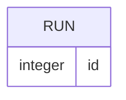

# Model schema — Archetype CLI

## Entity-Relationship diagram

## Entities

The CLI records one run for each invocation that opens its store. The health command returns the status and the number of stored runs.

The CLI also stores the version and application time of each applied migration. A run has no relationship to another entity.

---

> last updated: 2026-10-11T09:26:00Z
